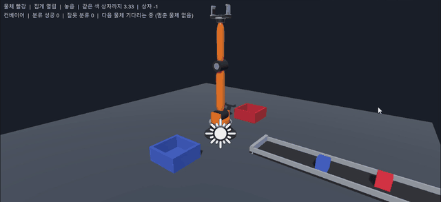
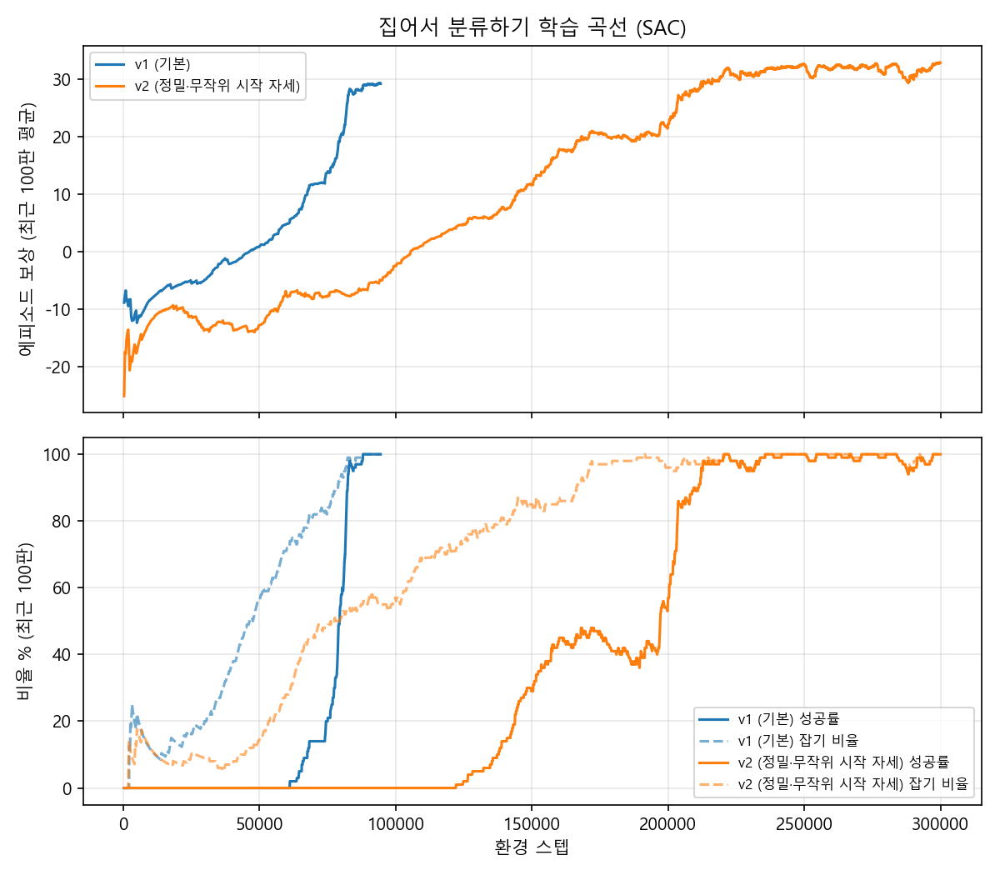

# SmartArm_Sorter — 로봇 팔 강화학습: 집어서 색깔별 분류하기

Unity 물리엔진으로 만든 3관절 로봇 팔이 컨베이어로 들어오는 빨강·파랑 물체를 집어 같은 색 상자에 분류한다. 팔은 Python 강화학습(Stable-Baselines3 SAC)으로 학습시켰다.

| 단계 | 과제 | 결과 |
|---|---|---|
| 1 | 목표 지점에 손끝 대기 | SAC 17/20 (PPO 14/20) |
| 2 | 물체를 집어 같은 색 상자에 넣기 | **20/20**, 상자 가운데 오차 0.03 |
| 3 | 컨베이어 연속 분류 (2단계 모델 재사용) | **30/30**, 잘못 분류 0, 분당 22.6개 |

자세한 설계·실험·분석은 [REPORT.md](REPORT.md)에 있다.



전체 시연 영상(물체 30개 연속 분류, 30/30 성공): [docs/media/conveyor_demo.mp4](docs/media/conveyor_demo.mp4)  
※ 이 영상은 Ticks Per Frame 2로 녹화해 실제보다 약 2.5배 빠르다. 1배속은 Unity의 `Real Time` 옵션으로 볼 수 있다.



## 구조

```
unity/ArmEnv.cs        Unity 환경 (팔·집게·상자·컨베이어를 실행 시 코드로 생성, 물리 진행, TCP 클라이언트)
python/
  arm_env.py           1단계 도달 환경 (Gymnasium)
  arm_train.py         1단계 학습·평가 (PPO/SAC/TD3/A2C, 실험 변형)
  arm_main.py          1단계 점검용 (랜덤·규칙 기반 정책, check_env)
  run_all.py           1단계 실험 일괄 실행
  plot_results.py      1단계 그래프·표
  pick_env.py          2단계 집기 환경 (상태 21, 행동 4, 잠재 함수 보상)
  pick_train.py        2단계 학습·평가 (v1 / v2 설정)
  pick_main.py         2단계 점검용 (역기구학 규칙 정책, 랜덤, check_env)
  plot_pick.py         2단계 그래프
  conveyor_demo.py     3단계 컨베이어 연속 분류 시연
  *.zip                학습된 모델 (arm_*: 도달, pick_sac: v1, pick_sac_v2: v2)
  logs/                학습 곡선 기록 (Monitor CSV)
  results.csv, pick_results.csv   평가 결과
docs/images/           그래프, 시연 장면
docs/media/            시연 영상
```

Unity는 물리와 "사실"(관절 각도, 위치, 잡힘 여부)만 보고한다. 상태·보상·종료 판정과 학습은 모두 Python이 한다. 둘은 `127.0.0.1:9999`에서 줄 단위 JSON으로 통신한다.

## 준비

- Unity 2022.3 LTS (2022.3.62f3에서 확인)
- Python 3.10 이상
  ```
  pip install -r requirements.txt
  ```

Unity 쪽 설정
1. 새 씬을 만들고 빈 GameObject를 하나 추가한다.
2. `unity/ArmEnv.cs`를 `Assets/`에 복사한 뒤, 그 GameObject에 붙인다. 바닥, 팔, 상자, 컨베이어, 카메라는 실행할 때 코드가 만든다.
3. Inspector에서 속도를 정한다. 이 값은 **Play를 멈춘 상태에서** 바꿔야 한다.
   - 학습·평가: `Ticks Per Frame` = 0 (최대 속도)
   - 시연·녹화: `Real Time` 체크 (실제 시계에 맞춘 1배속)

## 실행 방법

항상 **Python을 먼저 실행**하고, "Play 버튼을 누르세요"가 나오면 Unity에서 Play를 누른다. 명령은 `python/` 폴더에서 실행한다.

```
cd python

# 2단계: 학습된 모델 평가 (20판)
python pick_train.py eval v2

# 3단계: 컨베이어 연속 분류 30개
python conveyor_demo.py 30 v2

# 다시 학습하기 (SAC 30만 스텝, 약 2시간)
python pick_train.py train 300000 v2
python plot_pick.py

# 1단계: 도달 과제 실험 전체
python run_all.py 200000
python plot_results.py
```

## 핵심 설계

- **잠재 함수 기반 보상**
  - 잡기 전: φ = −(손끝~물체 + 물체~목표 + 1)
  - 잡은 뒤: φ = −(물체~목표)
  - 보상 = 3·(φ′ − φ) + 성공 +10 / 틀린 상자 −5 / 잃어버림 −5
  - 여러 단계를 하나의 함수로 이어서, 들었다 놓기를 반복해 점수를 버는 꼼수가 불가능하다.
- **v2 설정**: 잡히는 거리 0.22, 스텝당 12°, 무작위 시작 자세, 상자 가운데 놓기 보너스. v1(0.30, 8°, 고정 자세)보다 어려운 조건인데도 더 빠르고 정확하다.
- **컨베이어**: 추가 학습 없이 2단계 정책을 물체마다 이어 붙인다. 학습 환경과의 차이(상자에 쌓이는 큐브, 장애물, 시작 자세 등)를 진단해 고친 과정은 REPORT.md 6절에 정리했다.
