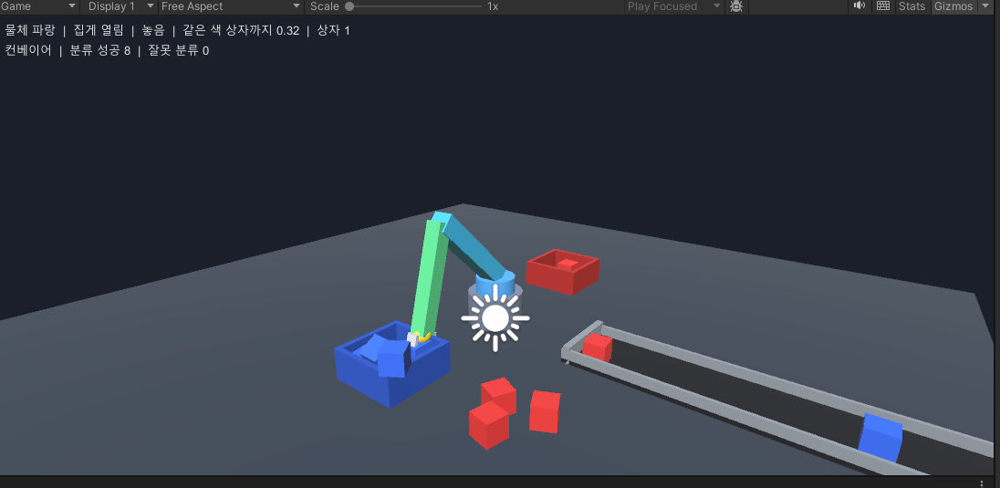
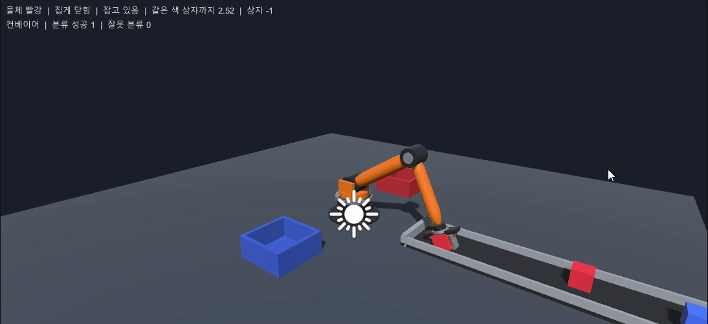
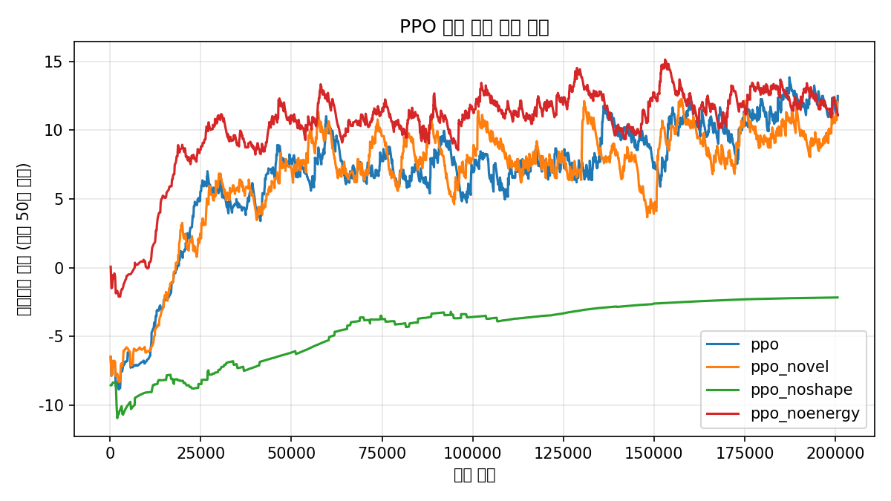
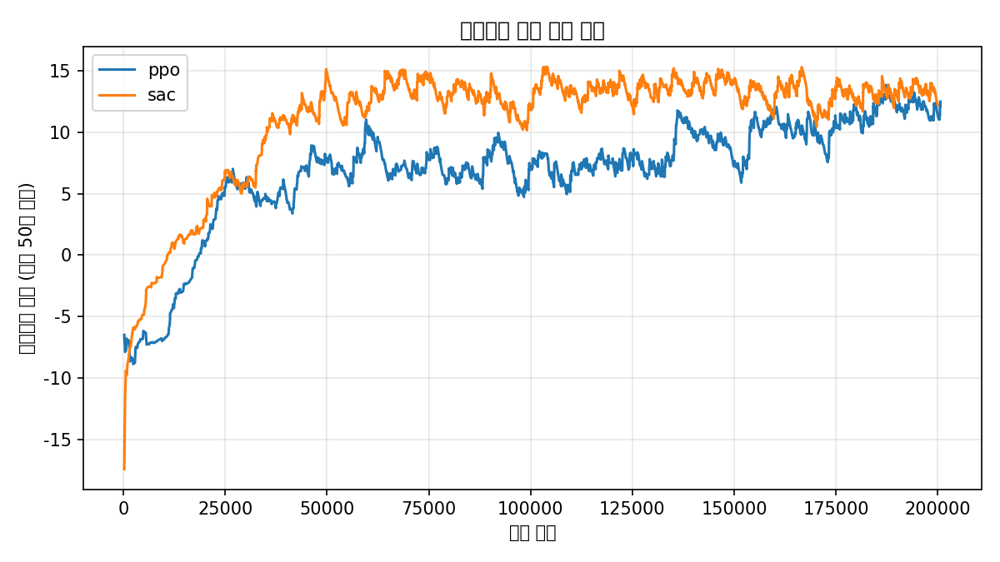
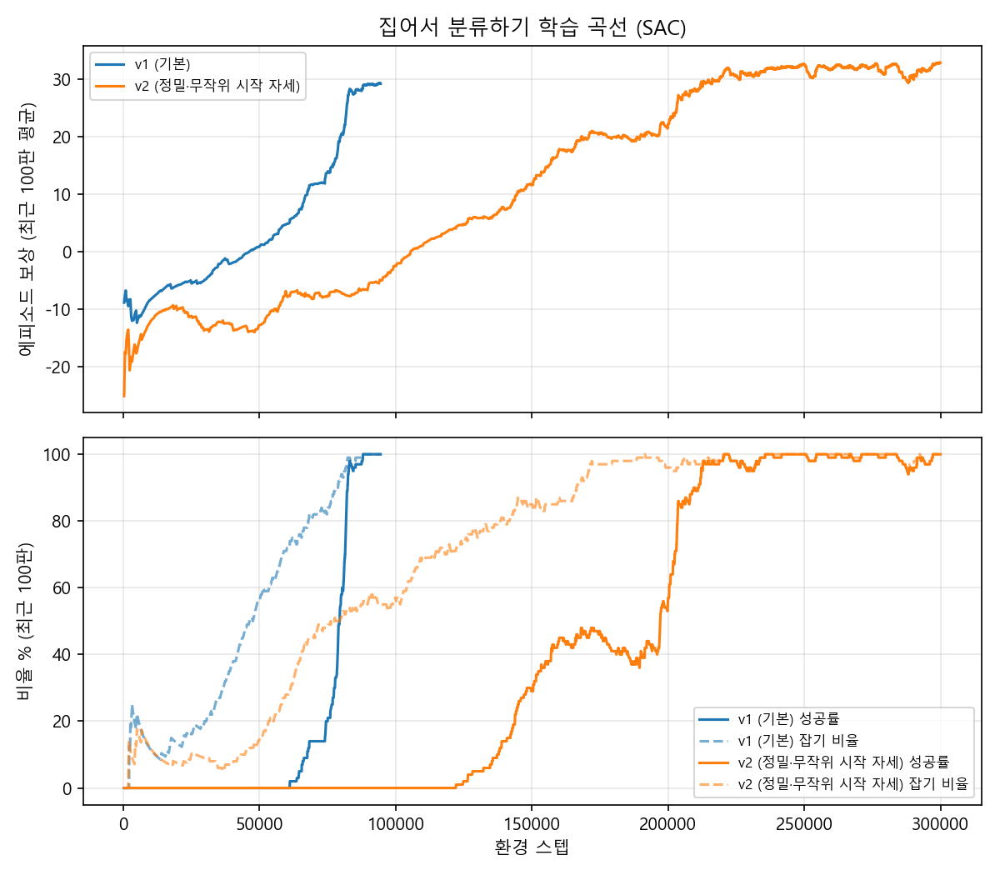
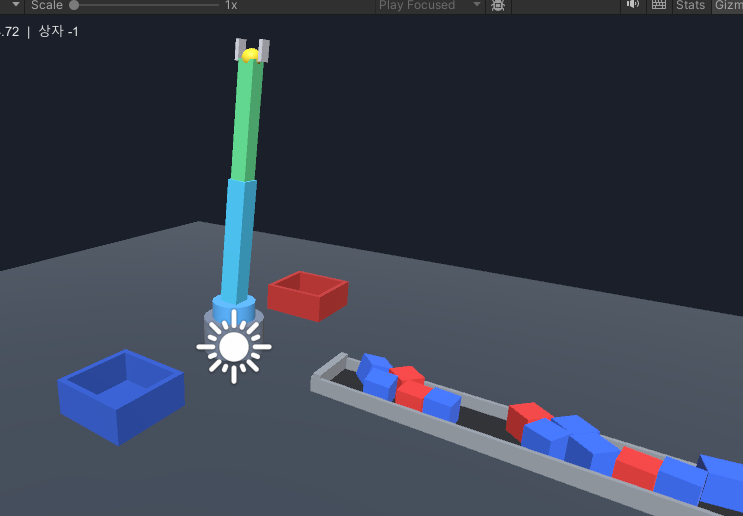
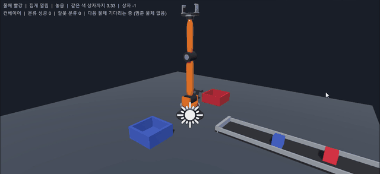
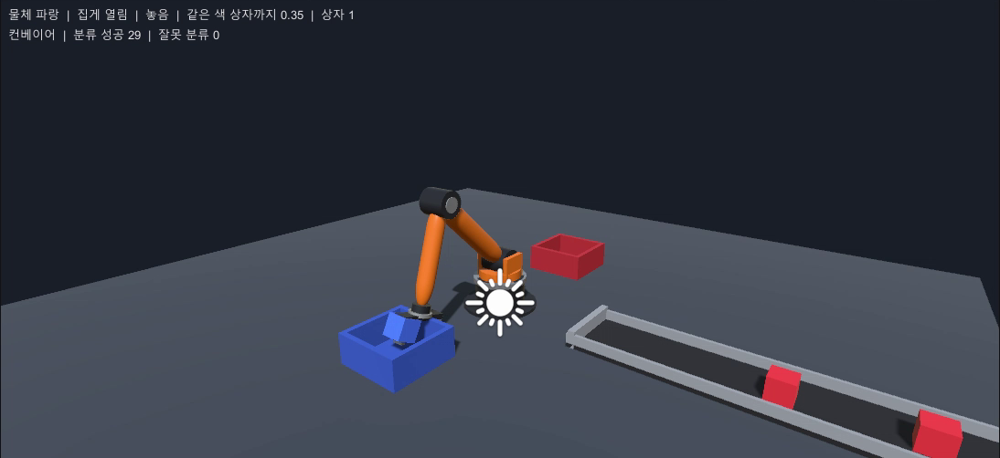

# 강화학습 기말 프로젝트 최종 보고서
## 3관절 로봇 팔의 물체 집기·색상 분류와 컨베이어 연속 분류 (Unity ArticulationBody + Python SB3)

과목: 딥러닝프로그래밍활용 / 학번 2301110329 박성준

---

## 1. 개요

Unity 물리엔진으로 만든 3관절 로봇 팔을 Python 강화학습 에이전트가 제어한다. 과제를 세 단계로 키워 갔다.

| 단계 | 과제 | 학습 | 핵심 결과 |
|---|---|---|---|
| 1 | **도달**: 무작위 목표 지점에 손끝 대기 | PPO 변형 4개 + SAC | SAC 17/20 성공, 보상 설계(shaping) 없이는 0/20 |
| 2 | **집어서 분류**: 물체(빨강/파랑)를 집어 같은 색 상자에 넣기 | SAC (v1, v2) | v1·v2 모두 20/20. v2는 더 정밀(가운데 오차 0.09 → 0.03)하고 빠름(29 → 26스텝) |
| 3 | **컨베이어 연속 분류**: 끝없이 들어오는 물체를 하나씩 분류 | 추가 학습 없음 (2단계 v2 모델 재사용) | **30/30 성공, 잘못 분류 0, 분당 22.6개** |

- Unity는 물리 시뮬레이션과 "사실"(관절 각도, 손끝·물체 위치, 잡힘 여부 등)만 보고한다.
- **상태·보상·종료 판정과 학습은 전부 Python**이 한다. 강화학습 설계는 Python 쪽에서 이루어진다.
- 통신: TCP `127.0.0.1:9999`, 줄 단위 JSON. Python이 서버, Unity가 클라이언트다.

## 2. 시스템 구조

```
 Python (Gymnasium 환경 + Stable-Baselines3)            Unity (ArmEnv.cs)
 ┌─────────────────────────────────────┐   reset/step   ┌──────────────────────────────┐
 │ 관측 계산 / 보상 계산 / 종료 판정      │ ─────────────▶ │ 관절 목표 각도 변경, 집게 개폐   │
 │ PPO / SAC 학습, 평가, 그래프          │ ◀───────────── │ Physics.Simulate 10틱(0.1초)   │
 └─────────────────────────────────────┘  관절·위치 사실  └──────────────────────────────┘
```

- **Unity → Python**: 관절 각도·각속도, 손끝·목표·물체 위치, 상자 위치, 잡힘 여부, 집게 상태, 물체 색, 물체가 든 상자 번호.
- **Python → Unity**: `reset`(seed, 과제 종류, v2 설정) 또는 `step`(관절 3개 + 집게 1개 행동).
- 물리는 `Physics.simulationMode = Script`로 직접 진행한다. 한 스텝은 0.01초 × 10틱이고, 결정적이다(같은 seed와 행동이면 같은 결과).
- Unity 화면 속도는 학습 속도와 분리했다.
  - 학습할 때는 최대 속도로 돌린다.
  - 시연할 때는 실제 시계에 맞춰 1배속으로 돌린다(Real Time 옵션).
  - 어느 쪽이든 물리 계산 결과는 같다.

## 3. Unity 환경

### 3.1 로봇 팔
- 고정 받침 위에 관절 3개가 있다.
  - Yaw(좌우 회전) ±150°
  - Shoulder(어깨) ±100°
  - Elbow(팔꿈치) ±120°
- 링크 길이는 윗팔 1.4, 아랫팔 1.2이다.
- `ArticulationBody` 관절마다 PD 구동기(stiffness 3000, damping 300, 최대 토크 600)를 단다. 에이전트는 **목표 각도의 변화량**을 행동으로 낸다.
- 실제 관절은 물리엔진이 계산한 힘과 관성에 따라 지연을 두고 목표를 따라간다. 그래서 단순한 기하 계산이 아니라 **관성이 있는 물리 시스템을 제어하는 문제**다.

### 3.2 집게와 물체 (집기 과제)
- 마찰로 잡는 실제 파지는 시뮬레이션에서 불안정하다. 그래서 잡기를 다음처럼 단순화했다.
  - 집게를 닫을 때 손끝과 물체의 거리가 기준값(v1 0.3, v2 0.22) 이하면 물체가 손끝에 붙는다.
  - 붙은 물체는 kinematic 상태로 손끝을 따라간다.
  - 집게를 열면 다시 일반 강체가 되어 중력으로 떨어진다.
- 물체는 한 변 0.24인 정육면체이고, 색은 빨강 또는 파랑이다.
- 상자는 두 개로, 받침에서 1.7 떨어져 있다. 빨강은 +Z 쪽, 파랑은 −Z 쪽이며 안쪽 반 너비는 0.35, 벽 높이는 0.35이다.
- "상자 안" 판정은 충돌 이벤트가 아니라 **기하 검사**(물체 중심이 상자 안쪽 범위에 있는지)로 한다. `Physics.Simulate`를 직접 호출하는 환경에서는 충돌 콜백을 믿을 수 없기 때문이다.

### 3.3 컨베이어 (3단계)
- 벨트는 제자리에 있는 kinematic 강체다. 매 틱 뒤로 순간이동했다가 `MovePosition`으로 원래 자리로 돌아온다. 그러면 물리엔진이 벨트가 앞으로 움직였다고 보고, 위에 놓인 물체를 마찰로 끌고 간다.
- 물체는 벨트 끝에서 계속 생성되고, 멈춤판 앞에서 멈춘다. 물체 12개를 돌려 쓴다.
- 같은 색이 3번 넘게 연속으로 나오지 않게 했다.

### 3.4 겉모습
- 산업용 로봇 팔 형태로 다시 디자인했다. 주황색 링크, 진회색 관절 하우징, 금속 집게, 고무 패드를 쓰고 그림자도 넣었다.
- 새 부품은 **충돌체가 없는 모양 전용 부품**이다. 학습에 쓰인 충돌체, 질량, 관절, 손끝 위치는 그대로라서 다시 학습할 필요가 없다.
- 재디자인 후에도 결정적 평가 결과(20/20, 평균 보상 32.63)가 같은지 확인하는 방법을 남겨 두었다.

| 재디자인 전 | 재디자인 후 (물체를 들고 상자로 가는 중) |
|---|---|
|  |  |

## 4. 1단계: 목표 도달

### 4.1 설계

| 항목 | 내용 |
|---|---|
| 행동 | 관절 3개의 목표 각도 변화량 (−1~1 → 스텝당 최대 8°) |
| 상태 (15차원) | 관절 각도 3, 관절 각속도 3, 손끝 위치 3, 목표 위치 3, 손끝→목표 벡터 3 (모두 정규화) |
| 성공 | 손끝–목표 거리 ≤ 0.2 → +10, 종료 |
| 접근 보상 | 3 × (이전 거리 − 현재 거리) |
| 시간 감점 | −0.01 / 스텝 |
| 에너지 감점 | −0.02 × ‖행동‖² |
| 바닥 감점 | 손끝 높이 < 0.12면 −0.2 / 스텝 |
| 제한 | 200스텝(20초) |

접근 보상은 **거리 변화량(차분)** 형태다. 그래서 가만히 있어도 보상이 쌓이는 문제가 생기지 않는다.

### 4.2 결과 (각 200,000스텝 학습, 20판 평가)

| 모델 | 성공 | 평균 보상 | 평균 스텝 | 마지막 거리 |
|---|---|---|---|---|
| ppo (기준) | 14 | 11.28 | 69 | 0.34 |
| ppo_novel (관절 속도 제거) | 12 | 9.28 | 88 | 0.47 |
| ppo_noshape (접근 보상 제거) | **0** | −2.01 | 200 | 2.26 |
| ppo_noenergy (에너지 감점 제거) | 13 | 11.79 | 78 | 0.29 |
| **sac** | **17** | **13.74** | **40** | 0.28 |

랜덤 정책은 20판 모두 실패했다(평균 보상 −5.88).




### 4.3 분석
- **접근 보상이 결정적이다** (0/20 대 14/20).
  - 성공 보상만 있으면 무작위 탐색으로는 목표에 닿을 일이 거의 없다.
  - `noshape`는 감점을 줄이려고 가만히 있는 쪽으로 수렴했다. 마지막 보상 약 −2.0이 시간 감점의 합과 같다.
- **SAC가 PPO보다 빠르다** (평균 40스텝 대 69스텝).
  - 연속 행동에서 오프폴리시 알고리즘의 표본 효율이 높다는 일반적인 경향과 맞는다.
  - 대신 학습 시간은 약 5배다(75분 대 16분).
  - 그래서 2단계부터는 SAC를 썼다.
- 관절 속도 제거와 에너지 감점 제거의 차이는 20판 평가의 오차 범위 안이다.

## 5. 2단계: 집어서 색깔별 분류

### 5.1 설계

**행동 (4차원)**: 관절 3개의 목표 각도 변화량 + 집게 1개(> 0이면 닫기).

**상태 (21차원)**

| 항목 | 차원 |
|---|---|
| 관절 각도 / 관절 각속도 | 3 + 3 |
| 손끝 위치, 물체 위치 (어깨 기준) | 3 + 3 |
| 손끝 → 물체 벡터, 물체 → 놓을 지점 벡터 | 3 + 3 |
| 잡고 있음, 집게 닫힘, 물체 색(빨강 −1 / 파랑 +1) | 1 + 1 + 1 |

"놓을 지점"은 물체 색과 같은 상자 위 0.7 높이다. 에이전트는 색 정보를 보고 어느 상자로 갈지 스스로 정해야 한다.

**보상: 잠재 함수(potential) 기반 shaping**

여러 단계(다가가기 → 잡기 → 옮기기 → 놓기)를 하나의 잠재 함수 φ로 정의했다.

| 상태 | φ |
|---|---|
| 잡기 전 | −(손끝~물체 거리 + 물체~놓을 지점 거리 + 1) |
| 잡은 뒤 | −(물체~놓을 지점 거리) |
| 성공 | 0 |

보상 = 3 × (φ현재 − φ이전) + 종료 보상 − 시간·에너지·바닥 감점

- 잡으면 φ가 1만큼 오른다. 엉뚱한 곳에 놓으면 그만큼 다시 깎인다.
- 그래서 **들었다 놓기를 반복해 점수를 버는 꼼수가 원천적으로 불가능**하다. 잠재 함수 차분 보상은 최적 정책을 바꾸지 않는다는 성질이 있다.
- 종료 보상
  - 맞는 상자: +10
  - 틀린 상자: −5
  - 물체를 잃어버림(떨어뜨림 등): −5
- 제한은 300스텝(30초)이다.

**두 가지 설정**

| | v1 | v2 |
|---|---|---|
| 스텝당 최대 관절 변화 | 8° | **12°** (빠르게) |
| 잡히는 거리 | 0.30 | **0.22** (정밀하게) |
| 시작 자세 | 항상 똑바로 선 자세 | **매 판 무작위 자세** |
| 가운데 놓기 보너스 | 없음 | **+5 × (1 − 가운데까지 거리 / 0.35)** |

v2는 v1이 쉽게 풀리자 더 정밀하고, 빠르고, 어떤 자세에서도 시작할 수 있게 하려고 만든 설정이다.

학습 설정 (SAC)
- learning rate 3e-4
- buffer 100k
- batch 128
- γ 0.99
- learning_starts 1000
- seed 0

### 5.2 학습 과정



| | v1 | v2 |
|---|---|---|
| 총 학습 | 94,465스텝 / 714판 (약 41분) | 300,000스텝 / 3,752판 (약 124분) |
| 첫 성공 | 61,118스텝 (205번째 판) | 122,193스텝 (408번째 판) |
| 최근 100판 성공률 95% 도달 | 82,677스텝 | 212,146스텝 |

- 두 설정 모두 **잡기 비율이 먼저 오르고, 그 뒤에 성공률이 급격히 올랐다.** 잡기를 먼저 배운 뒤 옮기기와 놓기를 배운 것으로 볼 수 있다.
  - v1은 잡기 비율이 약 70~80%가 된 직후에 성공이 나오기 시작했다.
  - v2도 같은 순서를 밟았다.
- v2는 약 2.5배의 스텝이 필요했다. 잡히는 거리가 좁아졌고 시작 자세가 매번 달라서, 같은 일을 더 많은 상황에서 배워야 했기 때문이다.
- v2는 11만 스텝 무렵까지 성공이 0이라 실패처럼 보였다. 그러나 잡기 비율이 꾸준히 오르는 것을 보고 학습을 계속했고, 결국 수렴했다.

### 5.3 평가 결과 (20판, 같은 seed 순서)

| 모델 | 성공 | 틀린 상자 | 시간초과 | 평균 보상 | 평균 스텝 | 상자 가운데까지 평균 오차 |
|---|---|---|---|---|---|---|
| v1 (`pick_sac`) | 20/20 | 0 | 0 | 29.50 | 29 | 0.09 |
| **v2 (`pick_sac_v2`)** | **20/20** | 0 | 0 | **32.63** | **26** | **0.03** |

- v2는 **더 어려운 조건(좁은 잡기 거리, 무작위 시작 자세)에서도 더 빠르게 끝냈다.**
- 상자 가운데 오차는 v1의 1/3이다. 상자 안쪽 반 너비가 0.35인데 평균 0.03만 벗어나서 거의 정중앙에 넣는다. 가운데 놓기 보너스가 의도대로 작동했다.
- 두 모델 모두 색을 틀린 경우가 한 번도 없다.

## 6. 3단계: 컨베이어 연속 분류 (학습 없이 재사용)

v2 모델을 그대로 가져와, 물체마다 한 판씩 이어 붙여 실행했다.

1. 물체가 멈춤판에 도착하면 판이 시작된다.
2. 팔이 물체를 집어 상자에 넣는다.
3. 팔이 정면 자세로 복귀하면 다음 물체로 넘어간다.

### 6.1 문제와 해결

학습 환경(바닥 위 물체 하나, 빈 상자)과 연속 작업 환경의 차이 때문에 처음에는 성공률이 30%였다. 원인을 하나씩 찾아 고쳤다.

| 초기: 벨트 끝에 물체가 몰려 기울고 겹침 | 상자에 큐브가 쌓이고 튕겨 나감 |
|---|---|
|  |  |

| 문제 | 원인 | 해결 |
|---|---|---|
| 넣었는데 성공으로 판정되지 않음 (30%) | 상자에 큐브가 쌓이면 두 번째 큐브의 중심 높이가 0.36이 되어 벽 높이 0.35를 넘는다. v2는 너무 정확해서 매번 이전 큐브 위에 정확히 쌓았다 | 다음 물체를 시작할 때 상자를 비운다 |
| 팔이 상자 벽·난간 사이에 끼어 시간초과 | 학습 환경에는 컨베이어가 없었다. 끼어 있는 동안 관절 목표만 계속 쌓였다 | 시연에서 팔이 벨트·난간·상자 벽을 통과하게 했다. 물체는 그대로 부딪힌다 |
| 들고 가는 물체가 줄 선 물체를 쳐서 날림 | 들린 물체는 kinematic이라 다른 물체를 강하게 민다 | 들고 있는 동안 그 물체의 충돌을 끈다 |
| 물체가 나란히 서거나 기울어 도착 | 좌우로 크게 흩어 생성해서 두 물체가 멈춤판 앞에 나란히 섰다 | 좌우 흩어짐을 ±0.1로 줄여 한 줄로 오게 하고, 기운 물체는 불량품으로 치운다 |
| 아직 굴러오는 물체를 집기 시작함 | 느린 벨트(0.3 m/s)에서는 굴러오는 물체도 "느리다"고 판정됐다 | 멈춤판 근처(0.1 이내)에 와야 시작한다 |
| 빨강 물체에서 가끔 망설임 (약 10%) | 팔이 직전 상자 쪽을 향한 채 시작했다. 재시도로 정면 자세에서 시작하면 항상 성공했다 | **매 물체마다 정면으로 똑바로 선 자세로 복귀** |

마지막 문제가 가장 흥미로웠다.
- v2는 무작위 시작 자세로 학습했는데도 "직전 상자를 향한 자세 + 빨강 물체" 조합에서 약했다.
- 진단 출력을 보니 실패한 물체는 멈춤판 바로 앞 정중앙, 가장 평범한 위치에 있었다. 환경 문제가 아니었다.
- 실패 직후 재시도한 시도는 모두 31스텝 만에 성공했다.
- 시작 자세를 통일하자 실패가 완전히 사라졌다.

**학습된 정책의 성능은 학습 분포 안에서도 상태에 따라 고르지 않을 수 있다**는 것을 보여 준다.

안전장치로 재시도 기능도 넣었다. 한 물체를 8초 안에 못 넣으면 팔을 세우고 다시 시도한다. 최종 실행에서는 한 번도 쓰이지 않았다.

### 6.2 최종 결과 (30개 연속)

| 처리 | 바르게 분류 | 잘못 분류 | 잃어버림 | 시간초과 | 재시도 | 분당 처리량 (팔 작업 시간 기준) |
|---|---|---|---|---|---|---|
| 30 | **30** | 0 | 0 | 0 | 0 | **22.6개** |

- 물체 하나당 파랑은 20~21스텝(약 2초), 빨강은 32~33스텝(약 3.3초)으로 **매번 거의 같은 시간**에 끝냈다.
- 빨강 상자 쪽으로 가는 경로가 더 길기 때문에 빨강이 더 오래 걸린다.





전체 영상: `docs/media/conveyor_demo.mp4` (30개 연속, 약 2.5배속으로 녹화)

## 7. 한계와 개선 방향

- **잡기 단순화**: 거리 기준으로 붙는 방식이라 실제 마찰 파지보다 쉽다. 실제 손가락 접촉으로 잡게 하면 훨씬 어려운 문제가 된다.
- **시드 1개, 평가 20~30판**: 작은 성공률 차이(예: PPO 변형 간 1~2판)는 우연일 수 있다. 시드를 여러 개로 반복하고 평가 판 수를 늘리면 신뢰도를 높일 수 있다.
- **컨베이어 환경 조정**: 컨베이어에서 100%를 얻으려고 환경 쪽을 바꿨다(상자 비우기, 정면 자세 복귀, 팔의 장애물 통과). 정책을 컨베이어 환경에서 직접 학습하거나 추가 학습(fine-tuning)하면, 이런 조정 없이도 견고한 정책을 얻을 수 있을 것이다.
- **물체 종류**: 같은 크기의 정육면체 두 색만 다뤘다. 크기·모양·색을 늘리면 상태 설계(예: 카메라 이미지 입력)도 함께 바꿔야 한다.
- 보상 가중치(shaping 3, 가운데 보너스 5 등)는 직접 정한 값이다. 민감도 분석은 하지 않았다.

## 8. 실행 방법

README.md의 "실행 방법"을 참고한다. 요약하면 다음과 같다.

```
cd python
python pick_train.py eval v2          # 집기 평가 20판 (Unity Ticks Per Frame 0)
python conveyor_demo.py 30 v2         # 컨베이어 시연 (Unity Real Time 체크)
```
